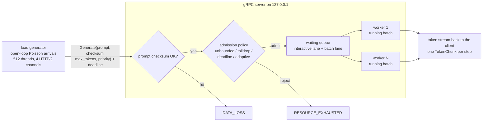
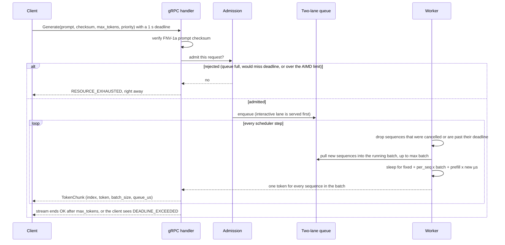
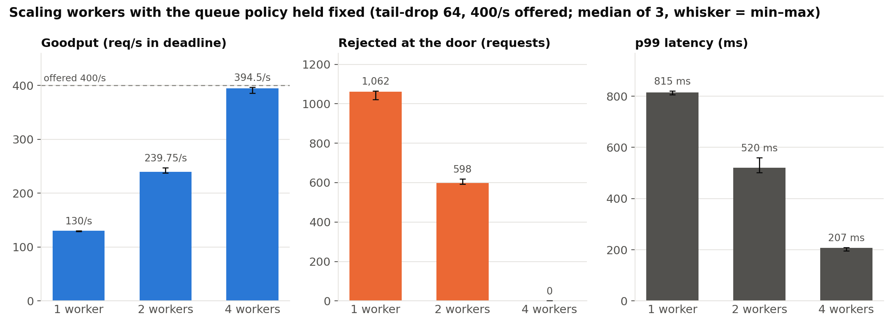

# local-rpc-inference-transport

*A tiny LLM-serving front end in C++20 + gRPC, with fake compute and real queueing.*

## TL;DR

All numbers are medians of 3 runs on one M2 laptop, rounded to whole numbers,
from [`results.json`](results.json).

- **Continuous batching kept time-to-first-token low.** At 200 requests/s,
  static and continuous batching both delivered 197/s of goodput, but TTFT p99
  was 265 ms for static and 28 ms for continuous.
- **No batching and no admission control collapses.** Goodput *fell* from 26/s
  (at 25/s offered) to 7/s (at 300/s offered), because almost every request
  waited most of its deadline and then died.
- **Saying no early beat letting requests time out.** At 300/s offered,
  deadline-aware admission (slack 0.8) delivered 267/s with 0 timeouts;
  accepting everything delivered 218/s with 317 timeouts and 6,958 wasted tokens.
- **Workers scaled once the queue policy was held fixed.** With tail-drop 64 at
  400/s offered: 130/s with 1 worker, 240/s with 2, 394/s with 4 (and 0 rejects).

I wondered why ChatGPT still feels fast when lots of people are using it. Some of
the answer is bigger GPUs, but a lot of it turned out to be **scheduling**:
how requests get batched, which ones go first, and which ones you turn away early
instead of letting them time out. So I built a small server that does those things
and measured what each choice changes.

There's **no model and no GPU** here. A "forward pass" is a sleep whose length
depends on the batch size. Everything around it is real: gRPC streaming,
protobuf, deadlines, cancellation, the batching scheduler, admission control, and
an open-loop load generator.



## What I built

- **Streaming tokens.** `Generate` is a server-streaming RPC. That gives
  time-to-first-token (TTFT) as its own measurement, separate from total latency.
- **Batching modes** (`--mode`):
  - `none`: one sequence per step.
  - `static`: gather up to `--max-batch` requests (or wait `--max-wait-us`), then
    run that batch until all of it is done.
  - `continuous`: new requests join the running batch at every step, like Orca and
    vLLM.

  The cost model, `2000 µs + 125 µs × batch + 500 µs × new prefills`, is made up.
  It's shaped like LLM decode, where reading the weights is the fixed cost, so
  batching is almost free per extra sequence.
- **Admission policies** (`--policy`):
  - `unbounded`: accept everything.
  - `taildrop`: reject once `--capacity` requests are waiting.
  - `deadline`: estimate this request's finish time from queue depth, free batch
    slots and the measured step time, and reject now if it would miss its deadline.
    `--deadline-slack` scales how much of the remaining deadline the estimate may
    use.
  - `adaptive`: an AIMD concurrency limit in the style of Netflix
    concurrency-limits. The limit goes up by +1/limit on each fast success and is
    multiplied by 0.9 on a deadline miss or a slow success.
- **Priority classes.** There are two FIFO lanes, and interactive requests are
  always dequeued first. You can turn this off with `--priority 0`.
- **Deadlines and cancellation.** The gRPC deadline reaches the engine. A sequence
  that runs out of time, or whose client went away, is dropped at the next step
  boundary, even mid-generation. Tokens already spent on it are counted as
  "wasted".
- **Integrity.** The server checks the prompt's FNV-1a checksum. Every token is
  `mix(prompt_checksum, index)`, and the client re-derives each one. FNV is for
  catching bugs; it is not security.
- **Honest client.** Arrivals follow a fixed, seeded schedule, so they don't slow
  down when the server does. Latency is measured from the *scheduled* send time,
  which avoids coordinated omission.

## How it works

The engine (`src/engine.cpp`) has no gRPC in it. N "replica" workers share one
waiting queue, and each worker runs a loop of scheduler *steps*. This is the
lifecycle of one request under continuous batching:



In `static` mode the "pull new sequences" step only happens when the batch is
empty (after waiting up to `max_wait` for it to fill), so a new request waits for
the whole previous batch to finish. In `none` mode the batch size is 1. That
single difference is what the first chart below is about.

Code layout:
- `src/admission.hpp` has the queue, the cost model, the predictor and AIMD. It is
  pure logic.
- `src/engine.{hpp,cpp}` has the scheduler and workers, with no gRPC.
- `src/main.cpp` has the gRPC server and the load generator.

## Results

Setup: one Apple M2 laptop (8 cores, 8 GB), macOS 27.2, AppleClang 21, gRPC
1.85.1, protobuf 36.2. Client and server ran on the same machine. Each cell
is the **median of 3 runs [min–max]**, and each run uses a different arrival seed
and has a 4 s arrival window. Unless a table says otherwise:
- 2 workers, max batch 16
- requests ask for 16–48 tokens
- 1 s deadline

"Goodput" means requests that got *all* their tokens before the deadline, per
second. Everything comes from `results.json` and was produced by
`python3 evaluate.py build/transport --reps 3` (533 s wall time). The charts are
drawn from `results.json` only, by [`scripts/make_figures.py`](scripts/make_figures.py).

This laptop was shared with other heavy jobs. I threw out my first attempts,
which ran at load averages of about 100–200. Steps took up to ~1.8× the cost model
there, and continuous batching at 200/s served only 127/s instead of 197/s.
`evaluate.py` now waits (with a time limit) for the 1-minute load average to drop
below 12 before each run. Across the 96 runs reported here, the load average before
each run was 4.6–11.7, and the measured step time was 1.01–1.22× the model. Both
are recorded per run in `results.json`.

### 1. Batching mode (same 2 workers, no admission control)


| offered | none: goodput / TTFT p99 | static: goodput / TTFT p99 | continuous: goodput / TTFT p99 |
|---:|---|---|---|
| 25/s | 26/s · 258 ms [175–320] | 26/s · 73 ms [69–78] | 26/s · **10 ms** [9–10] |
| 100/s | **12/s** [10–13] · 967 ms | 98/s · 115 ms [112–129] | 98/s · **12 ms** [11–22] |
| 200/s | 8/s [8–8] · 962 ms | 197/s · 265 ms [231–356] | 197/s · **28 ms** [23–70] |
| 300/s | 7/s [7–7] · 882 ms | 141/s [137–147] · 932 ms | **240/s** [235–246] · 910 ms |

At 200/s, continuous batching's p99 *total* latency was 206 ms [205–210] vs
408 ms [376–462] for static. (The chart also shows the 50/s runs, which the
table skips.)

### 2. Admission policy under overload (300/s offered, ~1,200 requests, same 2 workers, continuous)


| policy | goodput | p99 latency | rejected up front | timed out after admission | tokens wasted |
|---|---:|---:|---:|---:|---:|
| unbounded | 218/s [185–221] | 1000 ms | 0 | 317 [276–463] | 6,958 |
| tail-drop, 64 waiting | 239/s [234–241] | 510 ms [510–524] | 239 | **0** | 0 |
| tail-drop, 256 waiting | 226/s [220–234] | 999 ms | 20 | 265 | 6,315 |
| deadline-aware (slack 1.0) | 258/s [257–259] | 996 ms | 53 | 114 [86–118] | 2,974 |
| deadline-aware (slack 0.8) | **267/s** [266–272] | 923 ms [913–927] | 113 | **0** | 0 |
| adaptive AIMD | 228/s [224–230] | **291 ms** [290–295] | 281 | **0** | 0 |

At 150/s, which is under capacity, all six policies served everything: 146/s
goodput, p99 180–200 ms, zero rejects.

### 3. Priority lanes (30% interactive: 8–24 tokens, 300 ms deadline; 70% batch: 32–96 tokens, 3 s deadline; 250/s; deadline-aware admission)

| | interactive served | interactive TTFT p99 | batch served | batch timed out | total goodput |
|---|---:|---:|---:|---:|---:|
| one FIFO lane | 36 / 299 [30–38] | 245 ms | 714 / 714 | 0 | 188/s [178–200] |
| interactive first | **299 / 299** | **64 ms** [55–66] | 674 / 714 [620–676] | 40 [7–141] | 243/s [229–244] |

### 4. Worker count, with the queue policy held fixed (tail-drop 64, 400/s offered)



| workers | goodput | p99 | rejected |
|---:|---:|---:|---:|
| 1 | 130/s [129–130] | 815 ms | 1,062 of ~1,578 |
| 2 | 240/s [237–247] | 520 ms | 598 |
| 4 | 394/s [386–396] | 207 ms | 0 |

The old version of this project compared 1 worker with an unbounded queue against
4 workers with a bounded one, so it mixed up two effects. Here only one thing
changes per table.

### What surprised us

- **No admission control doesn't just get slow, it collapses.** With batch size 1,
  the server tops out around 25 requests/s (that's what it served at 50/s offered).
  When I offered 100/s, goodput didn't level off there. It *fell* to 12/s, and at
  300/s it was 7/s. Almost every request waited
  most of its deadline, got a few tokens, and then died, so the server was busy
  doing work nobody would use.
- **Static batching does fine on throughput but badly on TTFT.** Up to 200/s it
  matched continuous batching on goodput. But a new request had to wait for the
  whole previous batch to finish, so its p99 TTFT was 265 ms vs 28 ms.
- **A small queue beat a big queue.** Tail-drop at 64 had higher goodput and half
  the p99 of tail-drop at 256. The bigger queue only gave requests more room to
  wait and then time out.
- **The deadline predictor was a bit optimistic.** Requests actually took about
  1.07× their predicted time, so with slack 1.0 the borderline ones missed (114
  timeouts). I picked slack 0.8 after an exploratory run showed that bias, before
  the final run. With 0.8 it had the best goodput and zero timeouts. That's one
  setting on one workload, not something I tuned carefully.
- **No policy wins everywhere.** AIMD gave by far the lowest tail latency (291 ms
  p99) but turned away more work. The deadline policy kept the most goodput but let
  latency run close to the deadline.
- **Priority isn't free.** Interactive requests went from 36/299 served to 299/299.
  Batch requests paid for it: 40 timeouts on median. That's because the
  deadline predictor can't see interactive requests that will later jump ahead in
  the queue.

### What the numbers do NOT show

- **Real model throughput.** The "compute" is a sleep following a cost model I
  made up, so the absolute req/s say nothing about vLLM, TGI or any GPU.
- **Tight confidence intervals.** Three runs per cell shows the spread, nothing
  more. Some whiskers are wide (e.g. unbounded timeouts at 300/s: 276–463).
- **Network effects.** Client and server share one laptop over localhost.
- **A tuned slack value.** Slack 0.8 was picked from one exploratory run on this
  one workload.
- **Behaviour at thousands of streams.** The sync gRPC server uses a thread per
  in-flight stream; I only went up to a few hundred.

## Run it yourself

**Prerequisites:** CMake ≥ 3.20, a C++20 compiler, and gRPC + protobuf with CMake
config files. On macOS that's `brew install cmake protobuf grpc`. Python 3 for the
evaluation (standard library only), plus matplotlib if you want to redraw the
charts.

**Setup and build:**

```sh
git clone https://github.com/nikhils23j/local-rpc-inference-transport.git
cd local-rpc-inference-transport
cmake -S . -B build -DCMAKE_BUILD_TYPE=Release
cmake --build build -j8
```

**Quickstart** ("break it yourself"):

```sh
# terminal 1: one worker, no batching, no admission control
./build/transport server --port 50051 --workers 1 --mode none --policy unbounded
# terminal 2: offer 3x what it can do and watch goodput collapse (4 s arrival window)
./build/transport client --port 50051 --rate 100 --duration-s 4 | python3 -m json.tool
```

Things to try:
- `--mode continuous --max-batch 16`
- `--policy taildrop --capacity 8`
- `--policy deadline --deadline-slack 0.8`
- `--policy adaptive`
- `--interactive-frac 0.3 --i-deadline-ms 300` with `--priority 0` vs `1` on the server
- `--corrupt-checksum 1` (every request should get `DATA_LOSS`)

The client prints JSON with overall, per-class, and server-side counters. These
include wasted tokens, the mean batch size, the predictor's accuracy, and the
final AIMD limit.

**Full evaluation** (32 configurations × 3 runs, fresh server per run):

```sh
python3 evaluate.py build/transport --reps 3    # ~9 min (533 s recorded), writes results.json
python3 evaluate.py build/transport --quick     # smaller matrix for a sanity check
python3 scripts/make_figures.py                 # redraw docs/img/*.png from results.json
```

On a busy machine it can take longer, because `evaluate.py` waits (up to 60 s per
run, 240 s total) for the 1-minute load average to drop below 12.

## Tests

```sh
ctest --test-dir build --output-on-failure
```

Both tests take about 5 s total on my M2 (almost all of it the integration test).

| test | what it covers |
|---|---|
| `unit` (`tests/unit_tests.cpp`, no gRPC) | 11 engine and admission tests: AIMD limit updates, the two-class queue, the finish-time predictor, continuous batching respecting max batch, continuous vs static joining, cancelling a running sequence, tail-drop vs unbounded, expiring requests while queued, deadline-aware admission, adaptive-limit admission, and interactive requests served first |
| `integration` (`tests/smoke.sh`) | a real gRPC server and client over localhost: 200/200 requests complete with every token verified; a corrupted checksum gives 5/5 `DATA_LOSS`; overload with a tiny tail-drop queue rejects requests and accounts for every one; deadline-aware admission rejects early instead of timing out |

## Project layout

```
local-rpc-inference-transport/
├── CMakeLists.txt          engine library, unit tests, protoc codegen, transport binary
├── proto/inference.proto   Generate (server-streaming) and Stats RPCs
├── src/
│   ├── admission.hpp       queue, cost model, predictor, AIMD (pure logic)
│   ├── engine.hpp/.cpp     scheduler + workers, no gRPC
│   ├── common.hpp          shared helpers
│   └── main.cpp            gRPC server and open-loop load generator
├── tests/
│   ├── unit_tests.cpp      11 engine/admission tests
│   └── smoke.sh            end-to-end gRPC test
├── evaluate.py             experiment matrix → results.json
├── scripts/make_figures.py results.json → docs/img/*.png
├── docs/img/               README charts
├── results.json            recorded evaluation
├── INTERVIEW_NOTES.md
└── LICENSE
```

## What this isn't / limits

- It's not inference. No model, no tokenizer, no GPU, no KV cache, no memory
  pressure. Compute is a sleep plus a short spin, following a cost model I made up.
  The numbers describe *this* scheduler under *this* synthetic cost on one laptop.
  They don't say anything about vLLM, TGI or real model throughput.
- Everything ran on localhost, with client and server on the same 8-core machine.
  There's no real network. The client's own wake-up lag was about 5 ms at p99 in
  most runs and up to 24 ms in the worst one (recorded per run in `results.json`).
- The server is gRPC's sync API, with one thread per in-flight stream. That's fine
  at a few hundred concurrent streams, but it isn't how you'd build this for
  thousands.
- Three runs per cell is enough to see the spread, not enough for tight confidence
  intervals.
- There's no TLS or auth, and the server binds only to 127.0.0.1.

## More

How it works in more depth, why I made each choice, and the questions I expect
in an interview are in [INTERVIEW_NOTES.md](INTERVIEW_NOTES.md).

I built this as a personal project with AI pair-programming help. I can walk
through any line of it.
